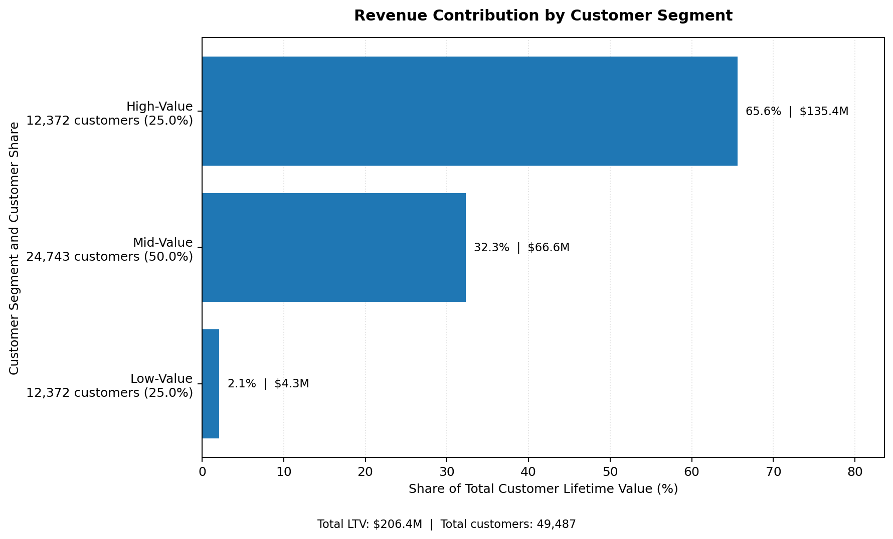
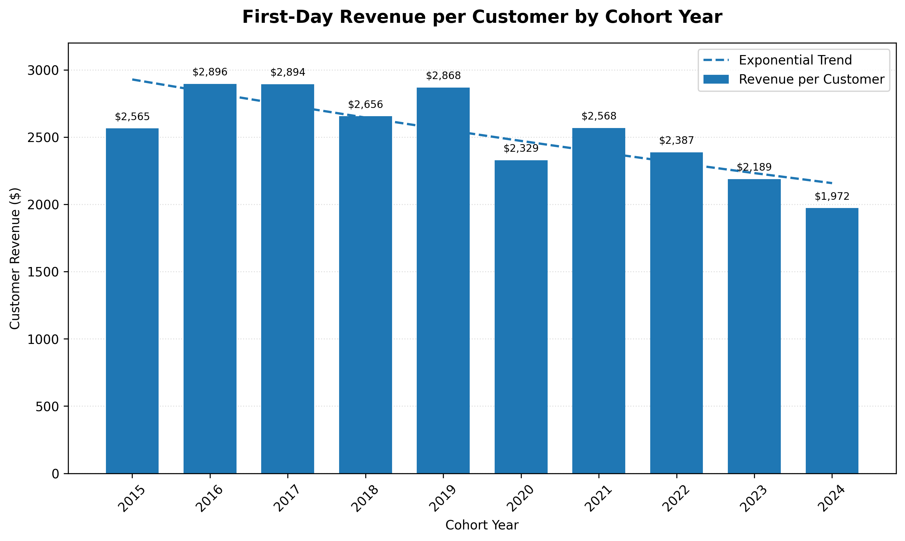
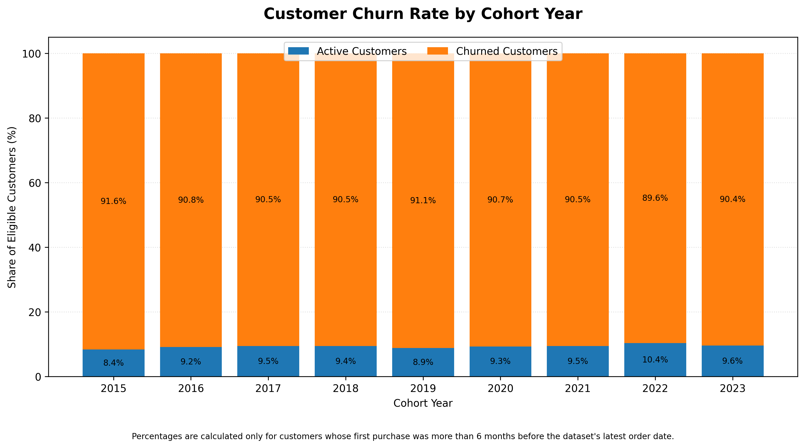
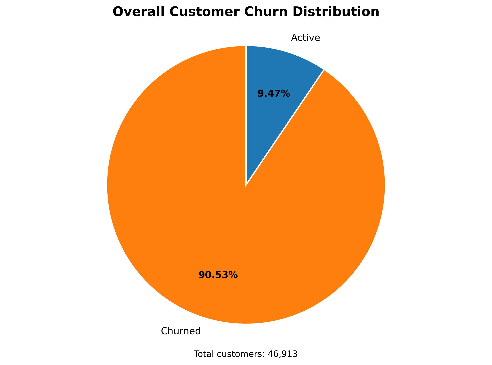

# Intermediate SQL - Sales Analysis

## Overview
This project analyzes customer behavior and purchasing patterns for an e-commerce company using PostgreSQL.

The goal is to understand customer value, identify revenue trends across customer cohorts, and evaluate customer retention and churn.

The analysis focuses on three key areas: customer segmentation, cohort analysis, and customer retention.

## Dataset & Data Source

This project uses the [**Contoso 100K**](https://github.com/lukebarousse/Int_SQL_Data_Analytics_Course/releases) dataset, a sample retail dataset representing a fictional company called Contoso.

The database was obtained from the accompanying resources for Luke Barousse's *Intermediate SQL for Data Analytics* course.

The dataset is intended for educational and analytical purposes. It does not represent verified sales transactions from a real company.

## Business questions
1. **Customer Segmentation:** Who are our most valuable customers and how much revenue do they generate?
2. **Cohort Analysis:** How do different customer groups generate revenue?
3. **Retention Analysis:** How many customers remain active, and how many have stopped purchasing?

## Analysis Approach

### 1. Customer Segmentation Analysis
- Calculate each customer's lifetime revenue (LTV)
- Segment customers into Low, Mid, and High-Value groups based on LTV percentiles
- Compare customer distribution and revenue contribution across segments

Query: [1_customer_segments.sql](/1_customer_segments.sql)

**Visualiazation**

**Key Findings**
- High-value segment (25% of customers) generate approximately 66% of revenue ($135.4M)
- Mid-value segment (50% of customers) generate approximately 32% of revenue ($66.6M)
- Low-value segment (25% of customers) generate approximately 2% of revenue ($4.3M)

**Business Insights**
- High-value customers are critical to business performance. Losing these customers could have a significant impact on revenue.
- Mid-Value customers represent an opportunity for growth through personalized offers, loyalty programs, and incentives to increase spending.
- Low-Value customers could be targeted with re-engagement campaigns and promotions designed to encourage repeat purchases.

### 2. Cohort Analysis
- Group customers by the year of their first purchase (cohort).
- Calculate the number of customers and total revenue for each cohort.
- Analyzed customer retention at a cohort level

Query: [2_cohort_analysis.sql](/2_cohort_analysis.sql)

**Visualiazation**

**Key Findings**
- First-day revenue per customer fluctuates across cohorts but shows a general downward trend in more recent years.
- Cohorts from 2022–2024 generate lower first-day revenue per customer than most earlier cohorts.
- The 2024 cohort has the lowest average first-day revenue, at approximately $1,972 per customer.
- Although total revenue varies significantly between cohorts, it is also influenced by the number of customers acquired.
    - NOTE: Although net revenue is increasing, this is likely due to larger customer base, which is not reflective of customer value

**Business Insights**
- Investigate why newer customers generate less revenue on their first purchase.
- Review acquisition channels, marketing campaigns, product preferences, and pricing strategies to identify possible reasons for the decline.
- Explore ways to increase initial purchase value through product recommendations, bundles, and targeted promotions.

*Note: This analysis measures revenue generated on the customer's first purchase date, not their complete lifetime value. The 2024 cohort may also be incomplete.*

### 3. Customer Retention
- Identify customers who have not made a purchase within the last six months.
- Determine each customer's latest purchase date.
- Classify customers as Active or Churned.
- Compare customer status across cohorts and across the entire customer base.

Query: [3_retention_analysis.sql](/3_retention_analysis.sql)

**Visualiazation - Churn by Cohort**

**Key Findings**
- Approximately 90% of eligible customers in each cohort are classified as Churned.
- Active customer percentages remain relatively consistent across cohorts, ranging from approximately 8% to 10%.
- No significant improvement in customer retention is visible across the analyzed cohorts.

**Business Insights**
- Strengthen early customer engagement through onboarding incentives, loyalty rewards, and personalized offers.
- Prioritize win-back campaigns for high-value customers who have stopped purchasing.
- Identify customer-specific behavioral patterns that could help detect churn risk earlier.

**Overall Customer Churn Distribution**

- **Active Customers**: 4,441 (9.47%)
- **Churned Customers**: 42,472 (90.53%)

*Note: Churn is defined as having no purchase within the six months preceding the latest order date in the dataset. Customers whose first purchase occurred within the last six months are excluded from this analysis.*

## Strategic Recommendations
1. **Customer Value Optimization** (Customer Segmentation)
    - Launch VIP program for 12,372 high-value customers (66% revenue)
    - Create personalized upgrade paths for mid-value segment ($66.6M &rarr; $135.4M opporunity)
    - Design price-sensitive promotions for low-value segment to increase purchase frequency

2. **Cohort Performance Strategy** (Customer Revenue by Cohort)
    - Target 2022-2024 cohorts with personalized re-engagement offers
    - Test product bundles, recommendations, and promotional strategies to increase initial purchase value
    - Apply successful strategies from high-spending 2016-2018 cohorts to newer customers

3. **Retention & Churn Prevention** (Customer Retention)
    - Strengthen first 1-2 year engagement with onboarding incentives and loyalty rewards
    - Focus on targeted win-back campaigns for high-value churned customers
    - Develop customer monitoring strategies to identify potential churn before customers become inactive

## Technical Details
**Database**: PostgreSQL

**Analysis Tools**: PostgreSQL, DBeaver, PgAdmin4

**Visualization**: ChatGPT

### Credits
Special thanks to [Luke Barousse](https://www.youtube.com/@LukeBarousse) for his excellent free SQL tutorial on YouTube, which provided the foundation and inspiration for this project.

This project was developed as a practical exercise to strengthen my SQL skills and apply data analysis techniques to real-world job market data.